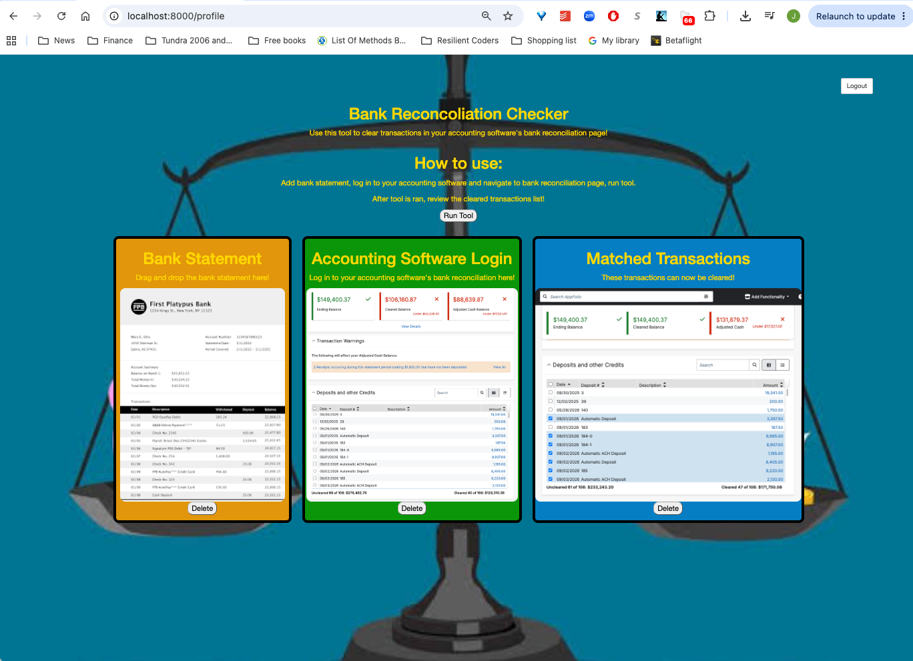

# ☀️ Fullstack Reconciliation Assist

Use this program to help with your bank reconciliations!
# Link

Coming soon!

# 📷 Images

# Planned Features

Upload bank statement.  
Login to acounting software of your choice.   
Run tool.  
Tool returns matched transactions, you can then clear!  

# CRUD

| Operation | What the User Can Do |
|---|---|
| **Create** | Create an account. |
| **Read** | View session history, individual transactions matched, progress, streaks, and routines. |
| **Update** | Upload Bank Statements, log in to accounting software. |
| **Delete** | Delete statements, delete matched transaction. |

## Tech Stack

- **Front End:** HTML, CSS, Vanilla JavaScript, EJS
- **Back End:** Node.js, Express
- **Database:** MongoDB

## Getting Started

Setup instructions will be added once the first working version is ready.
